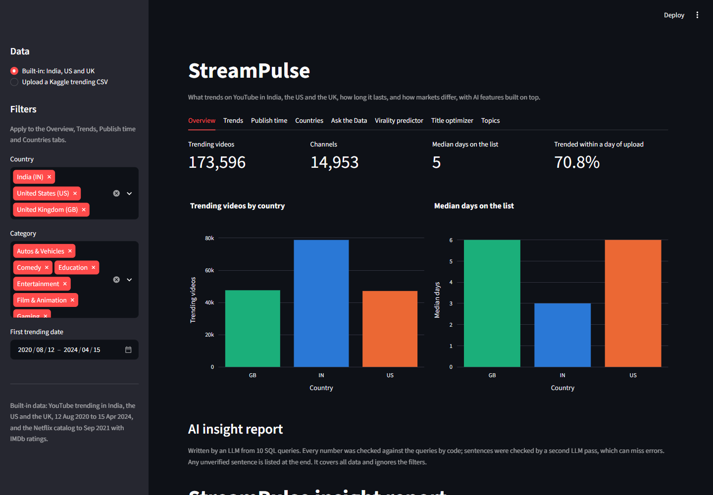
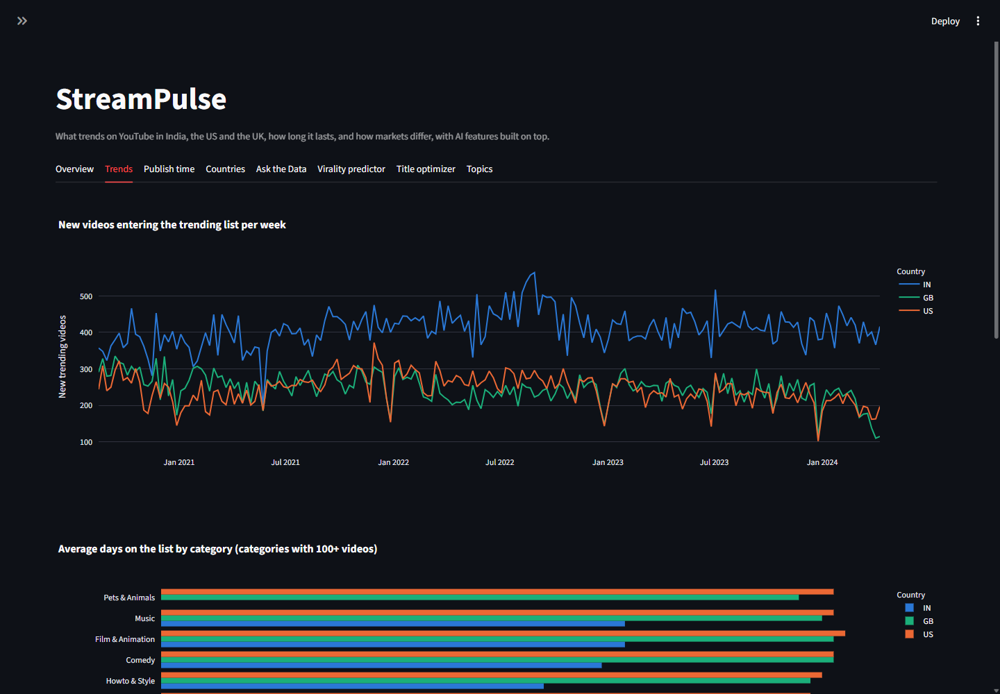
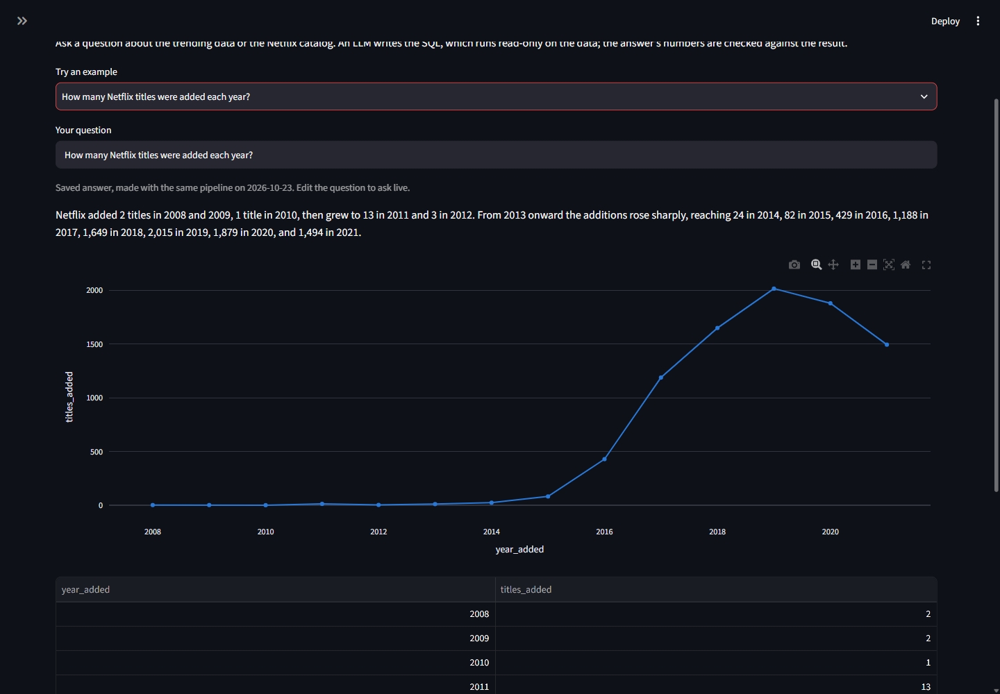
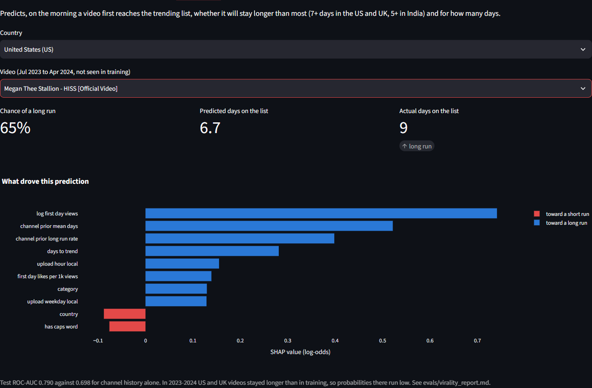
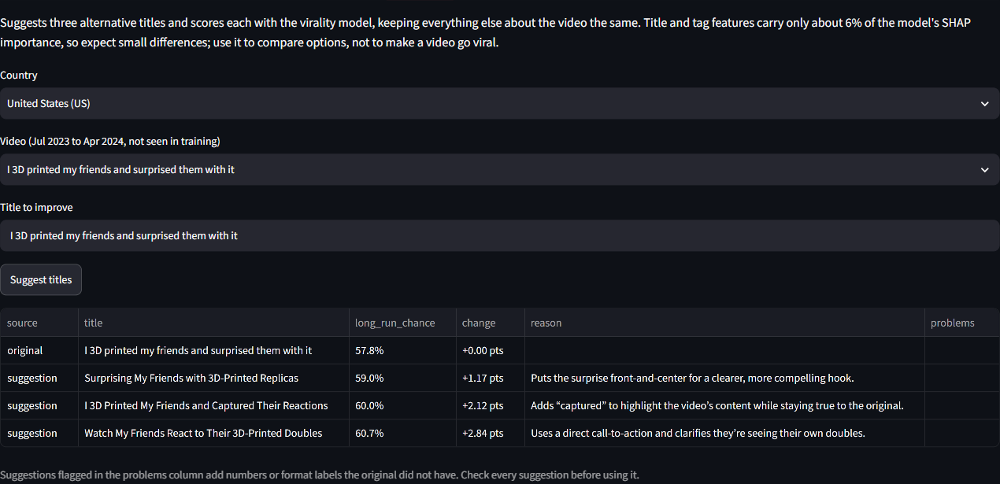
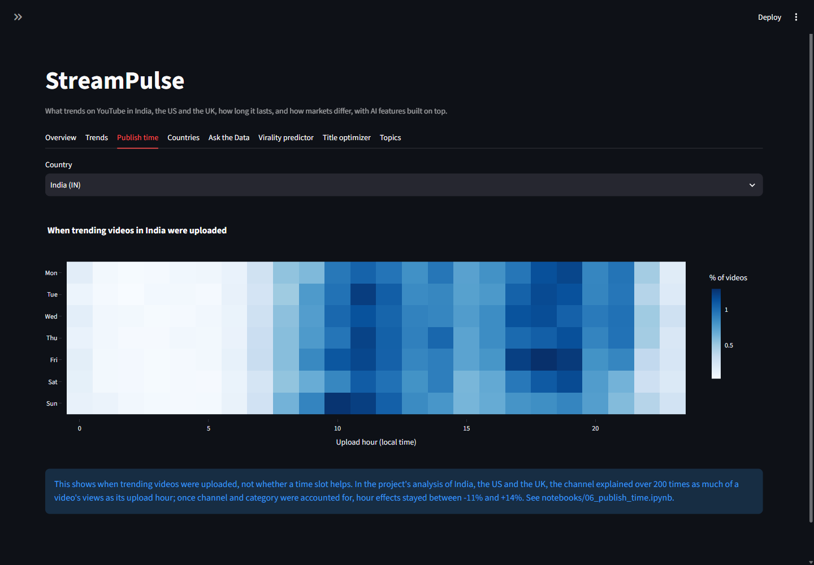
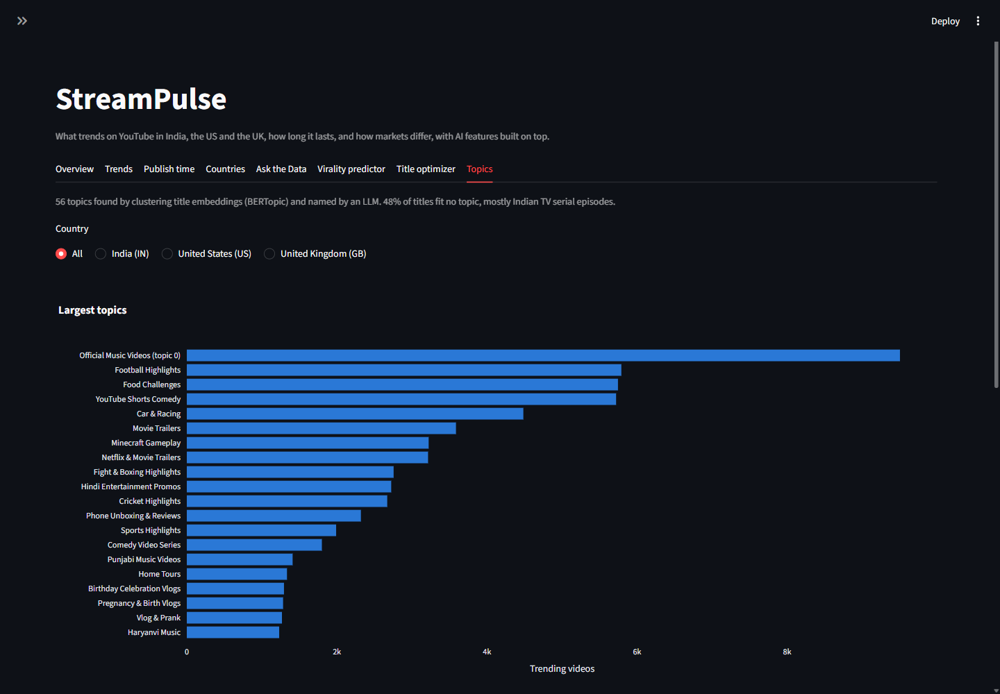
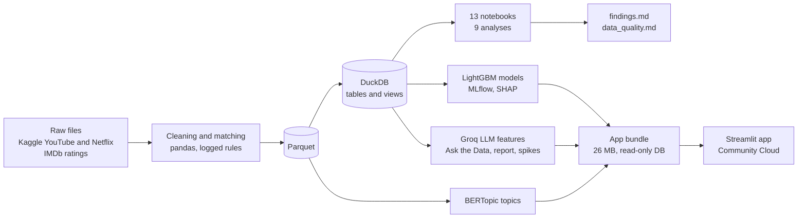

<h1 align="center">StreamPulse</h1>

<p align="center">
  <b>What trends on YouTube in India, the US and the UK, how long it lasts, and how the markets differ.</b><br>
  Nine statistical analyses of 777,826 trending-list rows, six AI features with measured results, and a live app.
</p>

<p align="center">
  <a href="https://streampulse-media-analytics.streamlit.app/"></a>
</p>

<p align="center">
  
  
  
  
  
  
  
  
</p>

<p align="center">
  <a href="https://streampulse-media-analytics.streamlit.app/"></a>
</p>

<p align="center">
  <a href="#key-findings">Key findings</a> &middot;
  <a href="#the-app">The app</a> &middot;
  <a href="#ai-features-and-how-they-were-measured">AI features</a> &middot;
  <a href="#how-it-works">How it works</a> &middot;
  <a href="#what-did-not-work">What did not work</a> &middot;
  <a href="#run-it-yourself">Run it yourself</a>
</p>

---

## At a glance

| | |
|---|---|
| **Data** | YouTube trending lists for India, the US and the UK, 12 Aug 2020 to 15 Apr 2024 (777,826 clean rows, 173,596 video-country runs, 14,953 channels), plus the Netflix catalog (8,802 titles, 84.8% matched to IMDb ratings) |
| **Analysis** | 9 business questions answered with survival analysis, regression with robust errors, chi-square, Gini with bootstrap intervals and rolling-origin forecasting ([findings](reports/findings.md)) |
| **AI** | Text-to-SQL, a LightGBM virality predictor with SHAP, an LLM title optimizer, an auto-written insight report, anomaly detection with LLM notes, and BERTopic topic discovery |
| **Checks** | Every AI feature has an evaluation file in [`evals/`](evals), and LLM numbers are checked against data by code, not by trust |
| **App** | 8 tabs with filters, upload of any country's Kaggle file, deployed on Streamlit Community Cloud |

## Key findings

| Question | Answer | Evidence |
|---|---|---|
| How fast do videos trend? | **India: 87.3% reach the list by the day after upload, against 57% in the US and UK.** About half of that lead comes from upload timing against the daily list capture; with timing and category controlled, India's odds fall from 5.5 to 2.7 times the US's. | [Analysis 1](notebooks/03_time_to_trend.ipynb) |
| How long do they stay? | **Median 3 days in India, 6 in the US and UK**, and the gap holds in every shared category, so it is not a category-mix effect. | [Analysis 2](notebooks/04_trending_duration.ipynb) |
| What drives likes and comments? | **Category drives likes, country drives comments.** Comedy gets about twice the likes per view of Entertainment; Indian videos get 58% to 63% fewer comments per view than US ones. | [Analysis 3](notebooks/05_engagement.ipynb) |
| When should you publish? | **There is no universal best time.** The channel explains over 200 times as much of a video's views as its upload hour; adjusted hour effects stay between -11% and +14%. | [Analysis 4](notebooks/06_publish_time.ipynb) |
| Do title tricks help? | **Barely.** All title features together explain 0.13% to 0.39% of time on the list after controls. Only question marks point the same way in all three countries (slightly shorter runs). | [Analysis 5](notebooks/07_title_features.ipynb) |
| One audience or three? | **The US and UK are about one market** (they share 52% of trending videos); **India is separate** (2.2% shared with the US). | [Analysis 6](notebooks/08_country_comparison.ipynb) |
| Is the list open to new creators? | **Concentrated everywhere:** Gini 0.67 to 0.69, and 7% to 9% of trending channels hold half of all list slots. | [Analysis 7](notebooks/09_channel_concentration.ipynb) |
| Can views be forecast? | **A 4-week weekday average is as good as SARIMA** for a monthly planning number (12.6% vs 16.2% error on the 30-day total) and far easier to explain. | [Analysis 8](notebooks/10_view_forecast.ipynb) |
| What happened to Netflix's catalog? | **Additions grew from 429 (2016) to 2,015 (2019) and drifted mainstream**; 2021 additions rate 0.44 IMDb points below 2016's, a third of it explained by the genre shift. | [Analysis 9](notebooks/11_netflix_catalog.ipynb) |

<details>
<summary><b>A data mystery solved along the way: India's 6 October 2022 break</b></summary>
<br>

On 6 October 2022 India's likes per 1,000 views dropped from about 60 to about 42 overnight, in every category, and
the daily list stopped holding a steady 200 videos. The engagement analysis found the break; topic discovery
explained it. **YouTube Shorts left India's trending list that day:** 79 of the 200 videos on 5 October were Shorts,
and none on 6 October. Shorts had left the US and UK lists earlier, around April 2022. Every analysis that compares
Indian engagement over time now stays on one side of that date. Details in
[data_quality.md](reports/data_quality.md).

</details>

## The app

**[streampulse-media-analytics.streamlit.app](https://streampulse-media-analytics.streamlit.app/)**. Sidebar filters
for country, category and date apply to the analysis tabs, and visitors can upload one country's file from the
Kaggle dataset (any of its 11 countries) to run the same views on new data.

<table>
  <tr>
    <td width="50%"><br><b>Trends.</b> Weekly intake, time on the list by category, and spikes with AI notes.</td>
    <td width="50%"><br><b>Ask the Data.</b> Plain-English questions become read-only SQL, with a chart and a number check.</td>
  </tr>
  <tr>
    <td><br><b>Virality predictor.</b> Chance of a long run on day one, with the SHAP reasons behind it.</td>
    <td><br><b>Title optimizer.</b> LLM title ideas, each scored by the model and checked for added claims.</td>
  </tr>
  <tr>
    <td><br><b>Publish time.</b> When trending videos were uploaded, in local time, with the caveat that matters.</td>
    <td><br><b>Topics.</b> 56 topics found in title embeddings and named by an LLM.</td>
  </tr>
</table>

## AI features and how they were measured

| Feature | How it works | Result |
|---|---|---|
| **Ask the Data** (Text-to-SQL) | `gpt-oss-120b` on Groq writes one DuckDB query from the question and the schema, retried once on a SQL error. Runs on a read-only connection with file access disabled; anything but a single SELECT is rejected. Numbers in the written answer are checked against the result rows. | **96.7%** (58 of 60) over 3 runs of 20 questions, including 2 trick questions it must refuse; 20 of 20 on the deployed app's database. [Report](evals/text_to_sql_report.md) |
| **Virality predictor** | LightGBM classifier and Poisson regressor, trained on the morning a video first trends, with leak-free channel history and a time-based split (train to 2022, validate H1 2023, test Jul 2023 to Apr 2024). Tracked in MLflow; explained with SHAP. | Long-run **ROC-AUC 0.790** vs 0.698 for channel history alone; days on the list **MAE 1.08** vs 1.21. [Report](evals/virality_report.md) |
| **Title optimizer** | The LLM suggests 3 titles using the analysis findings; each is scored by the virality model with every other feature unchanged, and code flags added numbers or format labels such as "Official". | Best clean suggestion gains **+0.46 to +0.95 points** on average across 3 runs. Small, as expected: titles carry about 6% of the model's SHAP importance. [Report](evals/title_optimizer_report.md) |
| **Auto insight report** | The LLM writes a one-page summary from 10 fixed SQL facts, citing a fact in every sentence with a number. Code checks every number; a second LLM pass audits each sentence; failures go back for up to 3 attempts. | Every final report passed the number check, but in 2 of 7 runs a human read found wording errors that passed every automated check. The committed report lists its one unverified sentence. [Report](evals/insight_report_eval.md) |
| **Anomaly detection** | Robust z-score of new videos per category per day against the previous 28 days (median and MAD); the small LLM writes a JSON note on what the titles share. | **284 spikes** flagged; the 20 largest all have usable notes, such as the Chandrayaan-3 Moon landing and the death of Queen Elizabeth II. [Report](evals/anomaly_report.md) |
| **Topic discovery** | Multilingual sentence embeddings of about 147,000 titles, clustered with BERTopic (UMAP and HDBSCAN) and named by the small LLM. | **56 topics**; 48% of titles fit none, mostly Indian TV serial episodes. This is what exposed the Shorts break. [Notebook](notebooks/13_topics.ipynb) |

## How it works



**Guardrails that make the LLM features trustworthy**

- The SQL model gets a read-only DuckDB connection with external file access turned off, a single-SELECT check, a
  200-row cap and a 15-second timeout. Tests check that statements such as `DELETE` are rejected, and the evaluation
  includes a request to delete data that must be refused.
- Every number an LLM writes is matched against the query results by code, allowing for rounding. Unmatched numbers
  are shown to the user, never hidden.
- The insight report and anomaly notes keep their sources (fact IDs, top titles) next to the text so a reader can
  check them.
- The four example questions in the app ship with saved answers, so the demo still works when the free Groq quota
  of 200,000 tokens a day is used up.

## What did not work

<details>
<summary><b>Seven things that failed, and what changed because of them</b></summary>
<br>

1. **Right number, wrong meaning.** The insight report wrote "only 2.5% of UK videos appear in India". The number
   was real, but it is the share of *India's* videos that trended in the UK (the right figure is 4.2%). It passed
   the number check, which led to a second LLM pass that audits each sentence against its fact.
2. **An empty report passed every check.** No numbers means no wrong numbers. A length check now catches it.
3. **The LLM echoed its own prompt.** 11 of the first 20 anomaly notes repeated the whole input. Asking for short
   JSON and validating it in code made 20 of 20 usable.
4. **Title suggestions that changed what a video claims to be.** For a K-pop music video the model added "(Live
   Performance)". The prompt forbids new claims; a code check for format labels now flags them, and the app says to
   check every suggestion.
5. **The grader was wrong, not the model.** One "failure" in the first Text-to-SQL run answered year and month in
   two columns instead of one. Questions can now accept more than one correct shape. The prompt was not tuned on the
   test questions, because that would inflate the score without improving the system.
6. **Peak-day engagement understated the US and UK.** Likes per view are about 20% lower on a video's peak day, and
   US and UK videos stay longer, so the first EDA chart was biased. All engagement now uses the first trending day.
7. **Deployment problems that only appeared off this laptop.** DuckDB could not read the raw Kaggle CSVs (line
   breaks inside quoted descriptions), so uploads use pandas. Git's Windows line-ending conversion broke the model
   files on a fresh clone; a `.gitattributes` rule keeps them byte-exact. Both were found by testing a clean clone
   with only the deployment requirements.

</details>

## Limitations

- **Only videos that trended are in the data.** Every finding is about what happens once a video is on the list,
  not about what makes a video trend in the first place.
- **The data stops on 15 April 2024**, and the Netflix catalog is a September 2021 snapshot.
- **The virality model has drifted.** US and UK runs grew longer in 2023 and 2024; the model still ranks them better
  than the baseline, but its probabilities there are too low. It would need retraining before real use.
- **LLM outputs can still be wrong in wording** even when every number is right, so the app keeps the sources
  next to the text.
- **The daily list capture time is unknown**, so time to trend is measured in days, not hours.

## Run it yourself

**Just the app** (its data is in the repository):

```bash
git clone https://github.com/Ankit-builds1/streampulse-media-analytics.git
cd streampulse-media-analytics
python -m venv .venv
.venv\Scripts\activate
pip install -r app/requirements.txt
streamlit run app/streamlit_app.py
```

For the AI features, copy `.env.example` to `.env` and add a free [Groq](https://console.groq.com) API key. Without
one, every chart, the virality predictor and the saved example answers still work. (On macOS or Linux, activate with
`source .venv/bin/activate`.)

**The full pipeline** (download the raw data first, see [Data sources](#data-sources)):

```bash
pip install -r requirements.txt
pip install -e .
python -m streampulse.clean
python -m streampulse.netflix
python -m streampulse.database
python -m streampulse.virality
python -m streampulse.virality_model
python -m streampulse.topics
python -m streampulse.anomalies
python -m streampulse.insight_report
python -m streampulse.app_data
python -m streampulse.example_answers
pytest
```

The AI evaluations run with `python -m streampulse.ask_eval` and `python -m streampulse.title_optimizer`.

<details>
<summary><b>Project structure</b></summary>
<br>

```
streampulse/     cleaning, database, analysis helpers, models and AI features (importable package)
notebooks/       01 to 13: first look, EDA, the nine analyses, virality model, topics
sql/             analysis queries against the DuckDB database
reports/         findings, data quality, cleaning logs, insight report, anomalies, topics
evals/           evaluation reports and raw results for every AI feature
models/          saved LightGBM boosters used by the app
app/             Streamlit app, its slim requirements and its 26 MB data bundle
powerbi/         Power BI export, DAX measures, theme, build guide and expected values
tests/           95 tests: cleaning rules, leak-free features, SQL safety, number checks, uploads
images/          screenshots used in this README
```

</details>

## Data sources

Raw data is not committed. Download it into `data/raw/` as shown.

| Dataset | Files | Folder |
|---|---|---|
| [YouTube Trending Video Dataset](https://www.kaggle.com/datasets/rsrishav/youtube-trending-video-dataset) (Kaggle, rsrishav) | `IN_`, `US_` and `GB_youtube_trending_data.csv` and the matching `_category_id.json` files | `data/raw/youtube/` |
| [IMDb non-commercial datasets](https://developer.imdb.com/non-commercial-datasets/) | [`title.basics.tsv.gz`](https://datasets.imdbws.com/title.basics.tsv.gz) and [`title.ratings.tsv.gz`](https://datasets.imdbws.com/title.ratings.tsv.gz), kept gzipped | `data/raw/imdb/` |
| [Netflix Movies and TV Shows](https://www.kaggle.com/datasets/shivamb/netflix-shows) (Kaggle, shivamb) | `netflix_titles.csv` | `data/raw/netflix/` |

IMDb data is for personal and non-commercial use only.

## Next steps

- Finish the Power BI report. The star-schema export, DAX measures, theme and a page-by-page build guide with
  expected values are in [`powerbi/`](powerbi/README.md).
- Retrain the virality model on 2023 and 2024 data to fix its drift, and test whether calibrating it per country
  closes the gap in US and UK probabilities.
- Retrieval for the title optimizer: show the most similar past trending titles, found with the existing
  embeddings, next to each suggestion.
- New test questions for Text-to-SQL, written after the fact, to measure the comma-separated-list fix honestly.

---

<p align="center">
  Built by Ankit Dash &middot; <a href="https://github.com/Ankit-builds1/streampulse-media-analytics">GitHub</a> &middot;
  <a href="https://streampulse-media-analytics.streamlit.app/">Live app</a>
</p>
