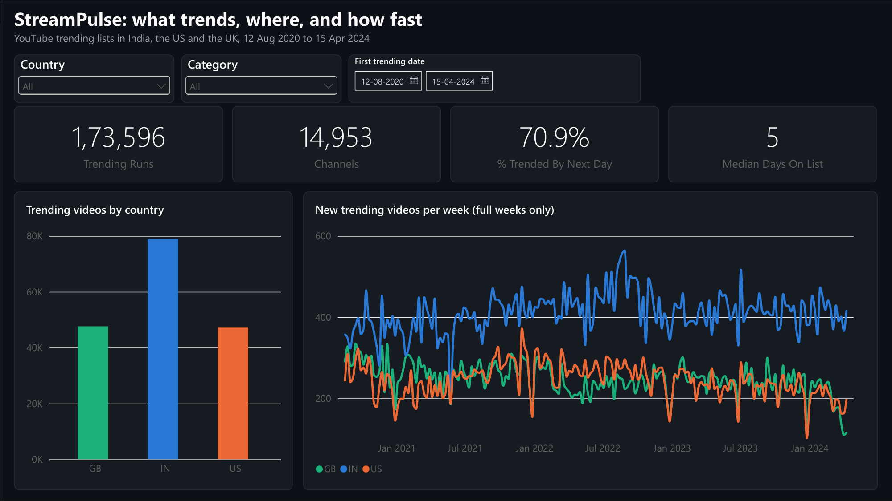
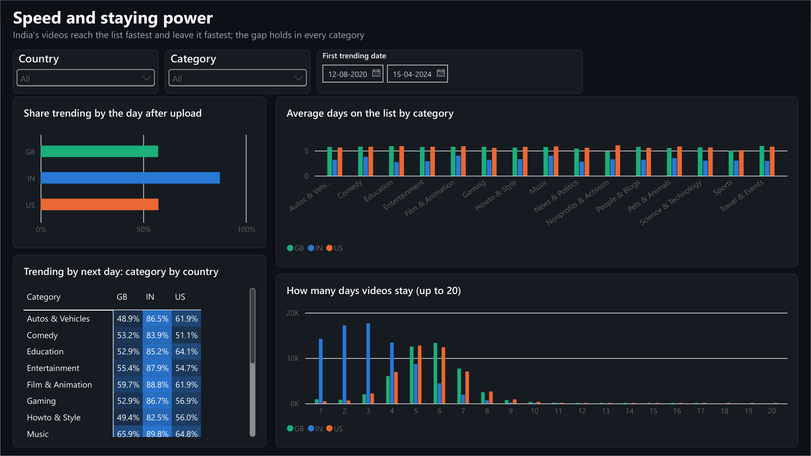
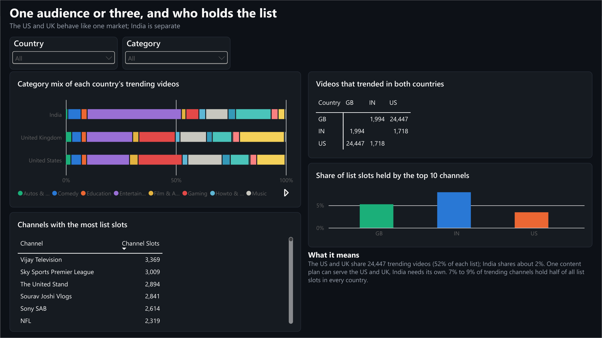
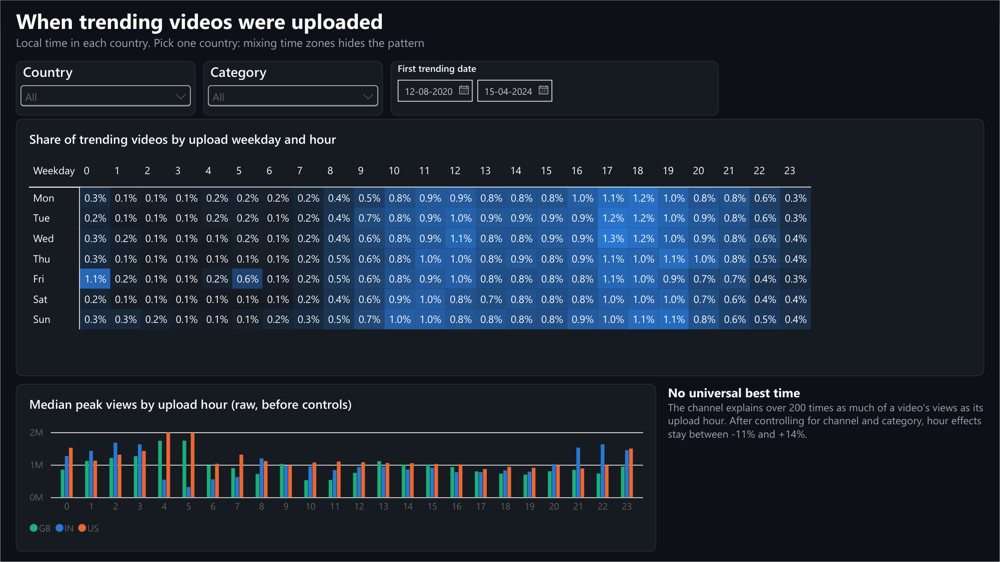
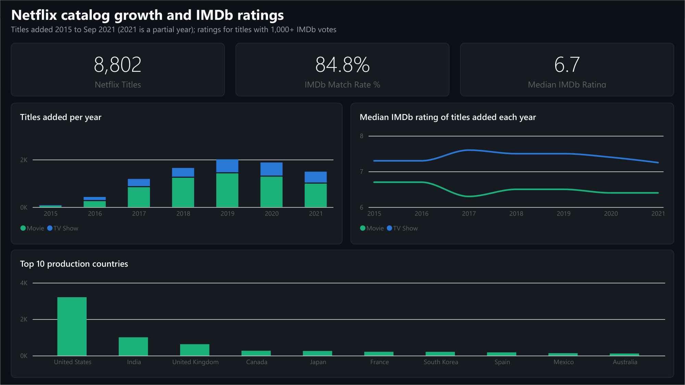

# StreamPulse in Power BI

A seven-page Power BI report built from the same data and rules as the analysis and the Streamlit app. The report
is stored as a Power BI Project (`.pbip`): the data model and every page are plain text files generated by code,
so they can be reviewed in git and rebuilt in one command.

## Pages

| Page | What it answers |
|---|---|
| Overview | How many videos trend, how fast, and how the weekly intake moves (full weeks only) |
| Speed and staying power | Share trending by the next day, category-by-country heatmap, days on the list |
| Engagement | Likes and comments per 1,000 views on the first trending day, with India split at the Shorts change |
| Publish time | Upload weekday-by-hour heatmap in local time, with the controlled-analysis caveat |
| Markets and creators | Category mix, country overlap, top-10 channel share, channels with the most list slots |
| Netflix catalog | Titles added per year, IMDb ratings by year and type, top production countries |
| Spikes | Spikes per month and the 284 flagged spikes with their AI note and top titles |

<table>
  <tr>
    <td></td>
    <td></td>
  </tr>
  <tr>
    <td></td>
    <td></td>
  </tr>
</table>

## How it is built

| File | What it is |
|---|---|
| `data/*.csv` | Star-schema tables from `python -m streampulse.powerbi_export` (not committed) |
| `measures.dax` | All 23 DAX measures, with comments on the rules they apply |
| `streampulse_theme.json` | Dark theme; series colours listed so GB, IN and US get the app's colours |
| `StreamPulse.SemanticModel/` | Tables, column types, relationships and measures as TMDL, from `python -m streampulse.powerbi_model` |
| `StreamPulse.Report/` | The seven pages as PBIR JSON, from `python -m streampulse.powerbi_report` |
| `expected_values.md` | What each measure should show with no filters, computed from the same CSVs |

The model is a star schema: `fact_trending_runs` (one row per video per country, 173,596 rows) with lookup tables
for country, category, channel and date, plus channel slots, country overlap, Netflix titles, spikes and topics.
Flag columns such as `full_run_known` carry the analysis rules, so measures reproduce `reports/findings.md`
instead of counting a slightly different set of runs.

## Open it

1. Install Power BI Desktop (free, Windows).
2. From the project folder, build the tables: `python -m streampulse.powerbi_export`.
3. Open `powerbi/StreamPulse.pbip` and click **Refresh**. If the project is not in `D:\PROJECTS\STREAMPULSE`,
   first change the `DataFolder` parameter (Transform data > Manage parameters) to your `powerbi\data\` folder.

To change the report, edit `measures.dax` or `streampulse/powerbi_report.py`, then run
`python -m streampulse.powerbi_model` and `python -m streampulse.powerbi_report` with Power BI closed (or use
its **Apply external changes** prompt).

## Checks

With no filters, the report matches [`expected_values.md`](expected_values.md), which matches the findings:

| Check | Report shows |
|---|---|
| Trending runs, channels | 173,596 and 14,953 |
| Trended by next day | 70.9% overall; 87.3% India, 57.4% US, 57.2% UK |
| Median days on the list | 5 overall; 3 India, 6 US and UK |
| India's slowest category vs fastest US or UK one | Howto & Style 82.5% vs UK Music 65.9% |
| Videos shared by the US and UK | 24,447 |
| First-day likes per 1,000 views, India before and after Oct 2022 | 58.1 and 30.0 |
| Netflix IMDb match rate, median rating | 84.8% and 6.7 |
| Top spike | India, News & Politics, 24 Aug 2023 (Chandrayaan-3), z 10.8 |

Power BI shows large numbers with Indian digit grouping (1,73,596) on a computer set to an Indian locale.
